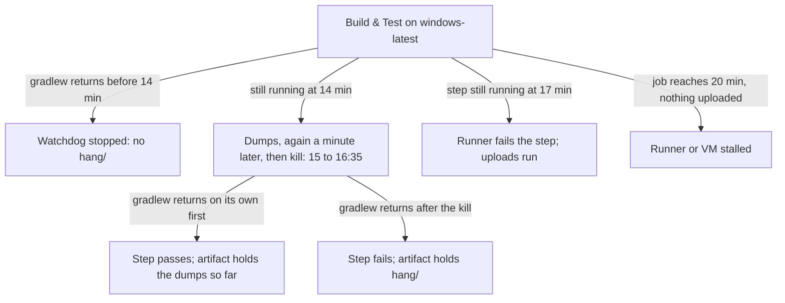

# 🐕 Windows CI hangs

Why the `windows-latest` Build & Test step runs under a watchdog and a heartbeat, what the watchdog writes to
`build/reports/hang/` and the heartbeat posts to a check run, and how to read both.

**Who it's for:** a contributor whose Windows CI job failed at 15 to 17 minutes, or timed out at 20.
**You'll be able to:** find the thread dumps in the job's artifact, read the heartbeat of a job that left nothing
else, tell a stuck thread from a slow one, and tell a JVM hang from a stalled runner.
**Before you start:** [Build and gates](build-and-gates.md#-what-build-runs), for the test timeouts the watchdog
backs up, and [its CI section](build-and-gates.md#-ci) for the jobs and artifacts.

[← Documentation index](../README.md)

- [Why a watchdog](#-why-a-watchdog)
- [What happens at 14 minutes](#-what-happens-at-14-minutes)
- [Reading the two rounds](#-reading-the-two-rounds)
- [The heartbeat](#-the-heartbeat)
- [Questions you might not think to ask](#-questions-you-might-not-think-to-ask)
- [Reference](#-reference)

---

## 🧭 Why a watchdog

Four `windows-latest` JDK 21 jobs (2026-10-14, 2026-10-15, and twice on 2026-10-17) sat in Build & Test until the
job's 20-minute `timeout-minutes`. GitHub then couldn't end the step within its five-minute grace, so each job
was cancelled at 25 minutes with no log kept and no upload step run: nothing said what had hung.

A healthy Windows step takes 5.8 to 12.4 minutes (146 jobs from 2026-10-10 to 2026-10-24). The Gradle `test`
timeout of 10 minutes and the classes' `@Timeout`s would have failed a plain test hang, with logs, by about 15
minutes, so something those timeouts can't reach was holding the step.

So on `windows-latest`, and only there, the `build-windows` job in `.github/workflows/ci.yml` runs Build & Test
with `.github/scripts/windows-hang-dump.ps1` started beside `./gradlew`, and stops it when `gradlew` returns. The step
also carries `timeout-minutes: 17` as a second net: if the watchdog can't end the step, the runner fails it at 17
minutes and still runs the upload steps. `ubuntu-latest` and `macos-latest`, which never stalled, run the plain step.



The step ends one of five ways, as the diagram shows. A normal return before 14 minutes leaves no `hang/`. A stall
gets two rounds of dumps and a kill, at 15 to 16 and a half minutes, after which the step fails and uploads them. A
`gradlew` that returns on its own between 14 minutes and the kill stops the watchdog, so the step passes and its
artifact holds the files written so far.

A watchdog that can't end the step is overtaken by the 17-minute step timeout, which still uploads. A job that
reaches 20 minutes with nothing uploaded had no JVM to blame.

Both stalls since the watchdog landed (2026-10-18 and 2026-10-24) were of that kind: the step outlived its own
17-minute timeout, which a working runner enforces, so the runner had stopped and the dumps went with the VM. The
heartbeat is for that case.

## ⏳ What happens at 14 minutes

The watchdog sleeps 14 minutes. If `gradlew` returned sooner, the step stopped it, and nothing was written. Otherwise
it writes a first round of files into `build/reports/hang/`.

`first-processes.txt` holds a timestamp, how many `java` processes it found, the free and total physical memory in
MB, and the 25 largest processes on the runner by working set, with their CPU seconds and start times. A stalled
runner shows here, in the memory line and the process list, when no JVM is to blame.

For every `java` process, the Gradle client and daemon, the test workers and any child JVM a test launched, it
writes `first-jvm-<pid>-command.txt`, the output of `jcmd <pid> VM.command_line`, whose `java_command` line says
which JVM it is, and `first-jvm-<pid>-threads.txt`, the output of `jcmd <pid> Thread.print -l`: a thread dump with
the locks each thread holds and waits for.

Every `jcmd` of a round starts at once, with one 45-second deadline for them all, so a round costs at most 45 seconds
however many JVMs there are. A `jcmd` still running at the deadline is killed, and its file ends with
`jcmd didn't answer in 45 s`: a JVM that can't serve an attach request, which is a finding in itself. Each `jcmd`'s
standard error goes to the file's `.err` twin, which is empty when all went well.

Sixty seconds after the first round ends, a `second-` set of the same files is written. Then the watchdog kills
every `java` process it finds, with its process tree, so `gradlew` returns a failure and the step fails on its own.
A JVM it couldn't kill is noted in `second-processes.txt`, and the file ends with `killed the JVMs`.

A round ends as soon as every `jcmd` has answered, so the kill comes at about 15 minutes into the step when they all
answer at once, and by about 16 minutes 35 seconds at the latest, before the step's 17-minute timeout.

The `Upload Coverage Report` step runs with `if: always()` on the JDK 21 legs, so the files go up in the artifact
`jacoco-report-jdk21-windows-latest`, under `build/reports/hang/`, with the JUnit XML of every test task that
finished before the kill, and the JaCoCo report only if the build had got that far.

> [!NOTE]
> The test task running when the JVMs are killed writes no JUnit XML: Gradle writes it when the task ends, and
> the task never does. The dumps are the record of that task.

## 🧵 Reading the two rounds

Download `jacoco-report-jdk21-windows-latest` from the failed run's summary page and open `build/reports/hang/`.

### Find the JVM

Open each `first-jvm-<pid>-command.txt`. Its `java_command` line names the Gradle daemon
(`org.gradle.launcher.daemon.bootstrap.GradleDaemon`), a test worker
(`worker.org.gradle.process.internal.worker.GradleWorkerMain`), the wrapper client (`gradle-wrapper.jar build
jacocoTestReport -PapiCheck.refresh`: a JVM started with `-jar` shows its jar, not a class), a child JVM a test
launched, or, when `buildSrc` was compiled rather than restored from the build cache, the Kotlin compile daemon that
built it (`org.jetbrains.kotlin.daemon.KotlinCompileDaemon`), idle since.

Start with a test worker: its `Test worker` thread runs the test, or waits on the thread JUnit runs a `@Timeout`
test's body on ([why](build-and-gates.md#-what-build-runs)), so the stuck frames may be on that thread instead. A
child JVM the test is waiting on has its own dump, by its own pid.

### Compare the two dumps of that JVM

A thread whose top frames are the same in `first-jvm-<pid>-threads.txt` and `second-jvm-<pid>-threads.txt`, 60
seconds apart, is stuck there. One whose frames moved is slow, not stuck: look at what it was doing, and at the
process list for memory pressure.

### Follow the locks

`Thread.print -l` lists, under each thread, the locks it holds (`- locked`) and the one it waits for
(`- waiting to lock`, `- parking to wait for`). Two threads each waiting for the other's lock is a deadlock; the
dump ends with a `Found one Java-level deadlock` section when the JVM detects one.

> [!TIP]
> To try the watchdog on your machine, start a JVM that sleeps, then run it against that pid alone, so it leaves
> your other JVMs alone: `pwsh -File .github/scripts/windows-hang-dump.ps1 -AfterMinutes 0.05 -AgainAfterSeconds 5
> -ProcessId <pid> -Out build/reports/hang`. It kills the JVM when it's done. Give it one pid that way: through
> `pwsh -File`, `-ProcessId 1234,5678` binds as the single pid `12345678`, so it finds no JVM and writes `0 JVM(s)`.
> Several pids bind only in-process: `& .github/scripts/windows-hang-dump.ps1 -ProcessId 1234,5678 ...`.

## 💓 The heartbeat

Only what leaves the VM while it runs survives a stall. The same step starts `.github/scripts/windows-heartbeat.ps1`
before the watchdog. It creates a **Windows heartbeat** check run on the commit (a pull request's head commit).

About every 60 seconds it adds a line: the time, time elapsed, free memory, commit charge and limit, CPU, each disk's
queue and idle time, the `java` processes and their memory, the newest JUnit XML and its time, and the five processes
with the most CPU time. The watchdog's `*-processes.txt` follow. The check run keeps the newest 120 lines, 65,000
characters at most.

When `gradlew` returns, the step's `finally` creates the stop file and waits up to 30 seconds. The heartbeat usually
sees it within half a second, adds a last line and marks the check run **neutral**: about ten lines on a healthy build.
It's evidence, not a [required check](build-and-gates.md#-ci).

A check run left **in progress** was never stopped by the `finally`, or its final post failed. After a stall, its last
line is the last minute the VM answered, and the lines before show the slope: free memory falling, a disk queue growing,
the newest JUnit result standing still. Lines past 17 minutes mean the VM outlived the runner.

Open it from the commit's checks or the GitHub CLI. Each title names its run and attempt; `filter=all` keeps a re-run's
heartbeat from hiding the first attempt's:

```bash
gh api -X GET repos/brantunger/unruly-engine/commits/<sha>/check-runs \
  -f check_name='Windows heartbeat' -f filter=all --jq '.check_runs[] | .output.title, .output.text'
```

Read its summary first, then its state with the job's:

| Heartbeat | Job | What happened |
| --- | --- | --- |
| Neutral, "The step reached its finally" | Passed or failed | The `finally` stopped it; read the job's log |
| Neutral, "The step reached its finally" | Cancelled at 25 minutes, no log | The runner didn't end the job: the VM was alive |
| Neutral, "Ran out its 30 minutes" | Any | No `finally` ran; the VM lived 30 minutes |
| In progress | Cancelled at 25 minutes, no log, nothing uploaded | The runner or its VM stalled |
| In progress | Failed at 17 minutes, or cancelled by a newer push | The runner ended the step, maybe before its `finally` |
| In progress | Passed | The final post failed after the `finally` (the printed log ends with `PATCH ... failed`, `stopped`) or outlasted the 30-second wait (no `stopped`) |
| None | Any | See [the question below](#theres-no-windows-heartbeat-on-the-commit-did-it-break) |

## ❓ Questions you might not think to ask

### The artifact has no `hang/` directory. Was the watchdog broken?

No: the step ended before 14 minutes, so the watchdog was stopped before it wrote anything, and the upload skips a
path that doesn't exist. A `windows-latest` job that failed in under 14 minutes failed for the reason in its log.

### `first-processes.txt` says `0 JVM(s)`. What then?

The build was still running at 14 minutes but no `java` process existed, so nothing of Gradle's was left to dump.
Read the process list and memory line in that file: the runner itself is the suspect.

### The job hit 20 minutes again and uploaded nothing. Didn't the watchdog run?

Then neither the watchdog at 14 minutes nor the step timeout at 17 could act: the runner, or the VM under it, had
stalled. Read its [heartbeat](#-the-heartbeat). Nothing sets `maxHeapSize` on the test tasks,
`maxParallelForks`, `org.gradle.jvmargs`, or an `-Xmx` for the child JVMs the tests launch: cap them on Windows if
the heartbeat shows memory pressure.

### Does the watchdog run on pull requests, or only on `main`?

On both: it's in every `build-windows` job's Build & Test step. Docs-only and release pull requests skip
`build-windows`, so neither runs it.

### There's no Windows heartbeat on the commit. Did it break?

Not when the run had no `build-windows` job, as on a docs-only or release pull request. On a fork's pull request
GitHub refuses its one `POST check-runs`, so it creates no check run and only writes its lines to `heartbeat.log`,
which the step prints. One that couldn't start leaves `The heartbeat didn't start` in the step's log. It never fails
the step.

### Can the watchdog fail a healthy build?

Only one still running when the kill comes: about 15 minutes in when every `jcmd` answers at once, 16 and a half
at the latest. A step that finishes between 14 minutes and then passes, and its artifact holds the rounds written
before `gradlew` returned: read them. The longest successful Windows step was 12.4 minutes, so a step that slows
past 14 is a change worth a dump of its own.

### Why does `build-windows` have `checks: write`?

For the heartbeat alone: its check run needs it. The Windows JDK 21 leg is its own job, `build-windows` (check name
`build (windows-latest, 21)`), so that no other job holds the permission. The heartbeat runs inside Build & Test
because a process a step starts may be killed when the step ends.

The cost: a check run made with the job's token comes from the GitHub Actions app, the source the
[ruleset](build-and-gates.md#-ci) requires for `ci-result` and `pr-title`. So code running in `build-windows`,
Gradle's plugins, the dependencies and the tests among them, could create a passing required check on any commit of
the repository while the job runs. Which of two same-name check runs GitHub judges isn't known.

That code still can't push, approve or merge. Pushes to `main` and pull requests from this repository or from
Dependabot get that token; a fork's pull request gets a read-only one.

## 📋 Reference

The watchdog's parameters, in `.github/scripts/windows-hang-dump.ps1`; CI passes `-AfterMinutes 14` and the defaults
for the rest:

| Parameter | Default | Meaning |
| --- | --- | --- |
| `-AfterMinutes` | `14` | Minutes to wait before the first round; a fraction is allowed |
| `-AgainAfterSeconds` | `60` | Seconds between the first round's end and the second |
| `-Out` | `build/reports/hang` | Where the files go; created if missing |
| `-ProcessId` | none | Dump and kill only these pids, for a trial on a machine with other JVMs; one pid through `pwsh -File`, several only in-process |

The files of a round, `first-` or `second-`:

| File | Holds |
| --- | --- |
| `<round>-processes.txt` | Timestamp, JVM count, free and total memory, the 25 largest processes; `second-` ends with `killed the JVMs` |
| `<round>-jvm-<pid>-command.txt` | `jcmd <pid> VM.command_line`: the JVM's arguments and `java_command` |
| `<round>-jvm-<pid>-threads.txt` | `jcmd <pid> Thread.print -l`: every thread's stack and locks, or `jcmd didn't answer in 45 s` |
| `*.err` | The `jcmd` call's standard error; empty when it answered |

The heartbeat's parameters, in `.github/scripts/windows-heartbeat.ps1`. CI passes none; outside CI, pass `-Stop` and
`-Log`:

| Parameter | Default | Meaning |
| --- | --- | --- |
| `-IntervalSeconds` | `60` | Seconds of waiting after each line is posted |
| `-MaxMinutes` | `30` | Stops on its own after this long, marking the check run neutral, saying so; a whole number |
| `-Stop` | `$RUNNER_TEMP/heartbeat.stop` | Stops, marking the check run neutral, once this file exists |
| `-Log` | `$RUNNER_TEMP/heartbeat.log` | Where every line and any failed API call go |
| `-HangDir` | `build/reports/hang` | Where it looks for the watchdog's `*-processes.txt` |
| `-Token`, `-Repository`, `-Sha`, `-ApiUrl` | `GH_TOKEN`, `GITHUB_REPOSITORY`, `HEARTBEAT_SHA`, `GITHUB_API_URL` | Where it posts; without a token it posts nothing |

The timings: heartbeat from the step's start, about every 60 seconds; watchdog at 14 minutes, each round at most 45
seconds, 60 seconds between rounds, kill at 15 to 16:35; step timeout 17 minutes, job timeout 20 minutes, cancel at 25.
