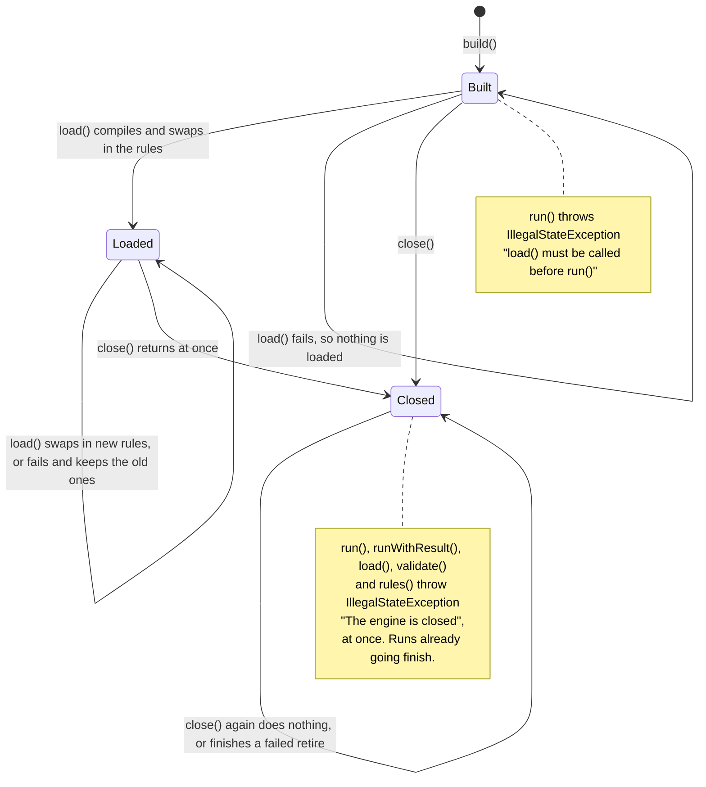
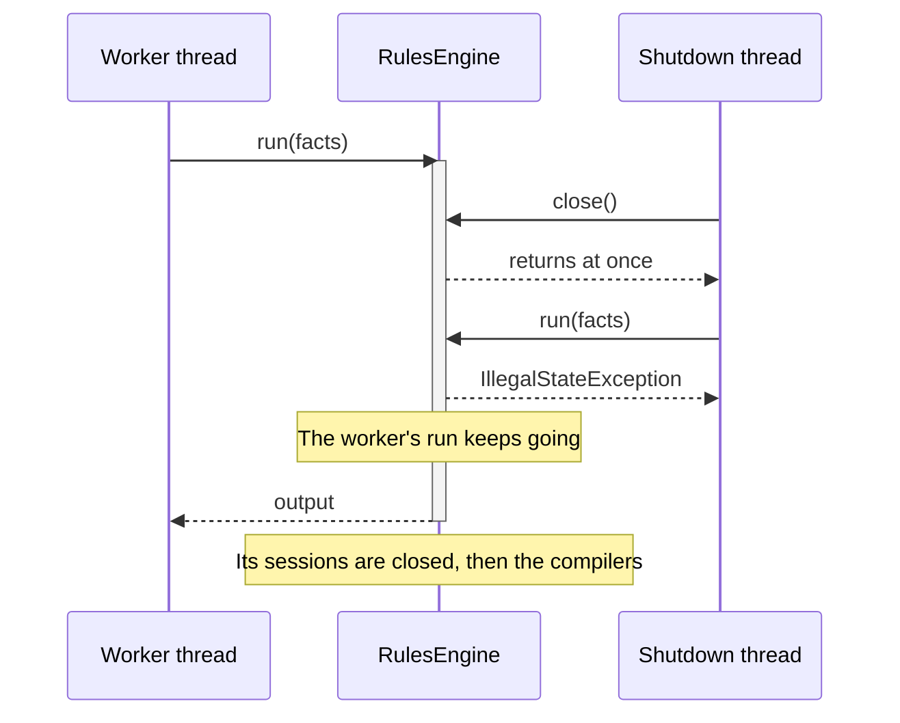
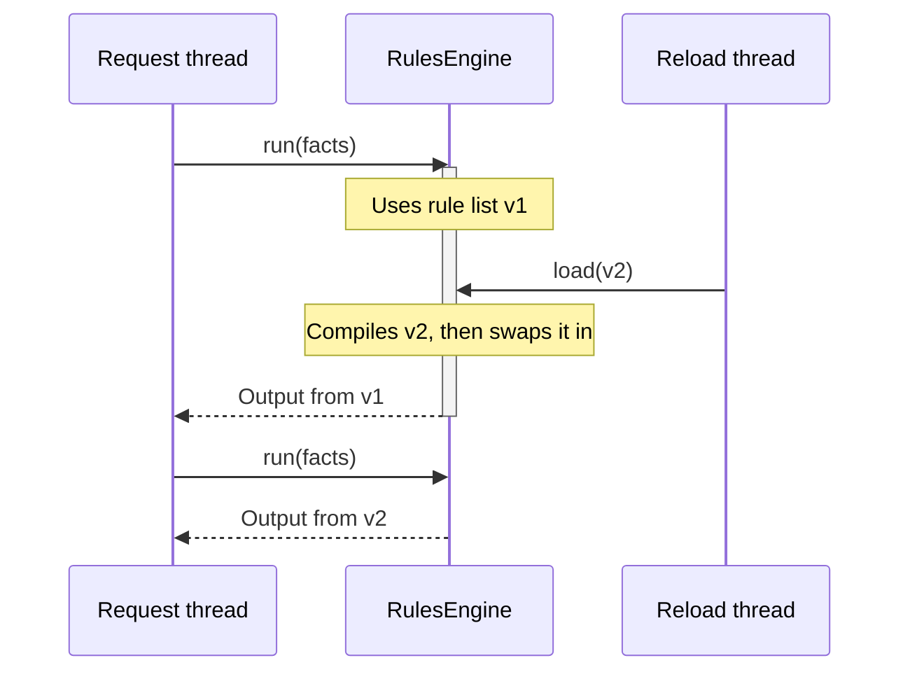

# 🧵 Thread safety

An engine is built once and shared by every thread in your application. This page says what that promises, what stays
yours, and what happens when you reload or close an engine under runs.

**Who it's for:** application developers sharing an engine across threads, or reloading rules in a running
application.
**You'll be able to:** close an engine without losing work, reload rules under traffic, and know what a run shares
with the runs around it.
**Before you start:** the [Quick start](../README.md#-quick-start). [Engines and runs](engines-and-runs.md) covers what
one run does.

[← Documentation index](README.md)

- [At a glance](#-at-a-glance)
- [Lifecycle and closing](#-lifecycle-and-closing)
- [Reloading rules while running](#-reloading-rules-while-running)
- [Compiled copies](#-compiled-copies)
- [Class loaders](#-class-loaders)
- [Gotchas](#-gotchas)
- [Questions you might not think to ask](#-questions-you-might-not-think-to-ask)

---

## 🧭 At a glance

| Method | Thread-safe? | When to call it |
| --- | :---: | --- |
| `RulesEngineBuilder` methods and `build()` | ❌ | During setup, on one thread. The engine it builds is thread-safe. |
| `load()` | ✅ | During setup, and at any time to reload; of concurrent loads, the last to finish compiling wins. |
| `validate()` | ✅ | At any time, from any thread: it compiles and discards, changing nothing. |
| `run()`, `runWithResult()` | ✅ | From any number of threads, once `load()` has returned. |
| `rules()` | ✅ | At any time: no rules before the first `load()`; after `close()` it throws. |
| `close()` | ✅ | When the engine is no longer needed; it returns at once, and runs in progress finish with their rules. |

An engine's languages, imports, listeners, [copy limit](glossary.md#copy-limit), copies at load, run timeout, output
type, output writer, declared facts and language options are fixed when it's built; only `load()` changes anything
afterwards.

An interrupt or a run timeout stops a run **between rules and when an expression returns**; see
[What stops a run](stopping-runs.md#-what-stops-a-run). Whether a running expression can be stopped depends on the
language: MVEL can't, so a rule that loops for ever blocks its thread; run rules you don't trust in a process of
their own.

### What you must keep thread-safe

The engine protects its own state. These parts are yours:

- **Facts:** a store can serve one run after another, and concurrent runs can share one that nothing changes; a new
  store per run is simplest. Don't share mutable fact objects between concurrent runs; see
  [Reusing and sharing a store](facts.md#-reusing-and-sharing-a-store).

- **The output supplier:** must return a new object on every call; a shared instance would be changed by several
  runs at once.
- **A custom `OutputWriter`:** one instance sets properties for every run, on many threads at once. The
  `OutputConverter` it's given is thread-safe.
- **Listeners:** one instance is called from every thread running the engine.

## 🛑 Lifecycle and closing

An engine is built, then loaded, then closed. The rules can be replaced as often as you like in between.



| Engine state | `run()` | `load()` | `rules()` |
| --- | --- | --- | --- |
| Built, nothing loaded | `IllegalStateException`, at once | Compiles the list and swaps it in | No rules, the checksum of an empty list, no load time |
| Loaded | Runs the rules | Compiles the new list, then swaps it in | The loaded rules, their checksum and load time |
| Closed | `IllegalStateException`, at once | `IllegalStateException`, at once, without compiling the list | `IllegalStateException` |

A `run()` before the first `load()` fails **at once**, without waiting for a `load()` still compiling on another
thread: load your rules before the application accepts traffic. `validate()` works in every state but Closed, and
changes none.

### Closing

> [!IMPORTANT]
> `close()` returns at once. It doesn't wait for runs in progress, and it doesn't interrupt them. To drain, stop
> sending work first, then close.



- A run holding a copy of the rules finishes normally and returns its result.
- Every new `run()`, `runWithResult()`, `load()`, `validate()` and `rules()` throws `IllegalStateException("The engine
  is closed")` at once. `load()` compiles nothing and logs no ERROR, even for a list that wouldn't compile; a `null`
  list still throws `NullPointerException`.
- A **nested run** started from an action or a listener of a run still going throws it too: it reads the engine's
  current rules, and a closed engine has none.

A run that read the engine's rules but hadn't yet borrowed a copy when `close()` retired them may still use them,
even after `close()` returned, if a run of them is still going when it borrows, as after a
[reload](#-reloading-rules-while-running). Otherwise it reads them again, finds a closed engine, and throws the same
`IllegalStateException`; one whose thread was interrupted, or whose deadline has passed, stops there instead, with a
message saying a reload or `close()` closed the rules; see [What stops a run](stopping-runs.md#-what-stops-a-run).

A `load()` that found the engine open isn't stopped by `close()`: if it fails, it throws what it would on an open
engine, such as `RuleCompilationException`; if it succeeds, its rules are dropped with the same
`IllegalStateException` or, if swapped in just before `close()`, closed with the rest, never served.

Each run's sessions are closed as it returns, or kept for a run still waiting for a copy of the same rules; copies
still kept, then the languages' compilers, are closed after the last run leaves. A failure to close a session or a
compiler is logged at WARN, unless a [nested run](nested-runs.md#-what-is-logged) logged it, and doesn't fail the run,
`load()` or `close()` that closes them, unless it's a [fatal error](glossary.md#fatal-error).

`RulesEngine` is `AutoCloseable`, so an engine for a short task fits a try-with-resources block. Closing twice does
nothing the second time, unless the first stopped part way.

A [fatal error](glossary.md#fatal-error) from closing sessions or compilers is rethrown once everything else is closed,
by the call or run that closes them; see [A fatal error while closing](error-handling.md#-a-fatal-error-while-closing).

### Draining before you close

Stop the work reaching the engine, then close:

```java
executor.shutdown();                                   // no new runs are submitted
executor.awaitTermination(30, TimeUnit.SECONDS);       // the runs in progress finish
engine.close();                                        // nothing is lost
```

In a web application, let the server's graceful shutdown drain requests before the engine bean is destroyed; see
[Shutting down](spring-boot.md#-shutting-down) for Spring Boot.

## 🔄 Reloading rules while running

`load()` compiles the whole new list, then swaps it in with one atomic write, together with the fact-name checks of
the languages its rules use.



For the runs:

- A run already in progress finishes with the rules it started with. `RunResult.ruleSetChecksum()` identifies them,
  and may already differ from `rules().checksum()`.
- Runs that start after the swap use the new rules.
- A run that starts **while the new list is still compiling**, or while `load()` makes its
  [copies at load](compiled-copies.md#making-copies-at-load), uses the old rules, without waiting.
- A run checks its fact names with the languages of the rules it runs, whichever list that is.

For the load itself:

- If the new list fails to compile, or a language fails to create or warm up a session for a copy at load, nothing
  is swapped: the old rules stay, and the sessions and compilers the failed load created are closed.
- A [fatal error while closing](error-handling.md#-a-fatal-error-while-closing) the replaced rules is thrown after the
  swap: the new rules serve. Otherwise, a failure that stopped retiring part way is logged at WARN and retried later.

- When two threads call `load()` at once, both compile their lists, and the last to swap in its rules, after making
  any copies at load, wins.
- Each condition and action is compiled on its own, so one rule's variables and inline `import` statements never
  change how another rule or a later reload compiles.

> [!WARNING]
> A nested run uses the engine's rules **as they are when it starts**, not the outer run's: after a reload, newer
> rules, which the outer run's checksum doesn't describe.

At the swap, the replaced list is retired and its idle [compiled copies](compiled-copies.md) closed at once, even
when runs wait on it. Runs waiting on it, for a place under a copy limit or a build slot, still finish on it, and
while any waits, a copy given back is kept for them, about one each up to the limit, so they reuse copies rather
than each building one.

Under `maxCopies(n)`, the replaced list never has more than `n` copies, apart from
[extra copies](glossary.md#extra-copy). The last run to leave it closes the copies still kept, and its compilers are
closed once, by whichever of that run and the `load()` closing the idle copies finishes second.

A run that read the engine's rules just before the swap uses that list only while a run of it is still going, and may
then take a kept copy or build one; when the list is already closed, the run starts again on the new rules, unless
its thread was interrupted or its deadline has passed, when it stops there. Copies aren't carried over: the first
runs after each `load()` build them again, unless the engine was built with
[`copiesAtLoad(n)`](compiled-copies.md#making-copies-at-load), when `load()` builds them before the swap.

## 📑 Compiled copies

Every run shares the rules as `load()` compiled them. What an expression language changes while its expressions run
lives in a *[session](glossary.md#session)*, and a **compiled copy** of the rules is one session for each language the
rules use. Each `run()` borrows a copy no other run is using, makes one if every copy is busy (as the first run after
`load()` does, unless the engine [makes copies at load](compiled-copies.md#making-copies-at-load)), and gives it back
when it finishes.

Copy count, limits and what a run waits for when they run out: [Compiled copies](compiled-copies.md). Runs from
virtual threads: [Virtual threads](virtual-threads.md).

## 🌳 Class loaders

Your facts' and output object's classes must be reachable from the **context class loader of the thread that calls
`load()`**: `load()` captures that loader and gives it to every expression language to find classes with.
Unless rules name MVEL's classes, it needn't see MVEL, or may hold a copy: generated code uses the engine's.
`RulesEngineBuilder` has no class-loader option; this loader is the only control.

This matters when the fact classes live apart from the application: in a plugin or tenant jar, a container's
application class loader or a test harness that isolates each case. Load the rules with that loader in place, then
restore the old one. A package import needs it at `load()` only.

A single-class import of one of them, `imports("com.plugin.Applicant")`, needs it around `build()` too, or the name
is imported as a package, silently. Put it around both: with one alone, what `run()` does depends on how the rule
uses the class, and the message differs.

```text
The loader is around   A rule creating one: new Applicant()             A rule reading a static: Applicant.MAX
load() only            could not resolve class: Applicant               unresolvable property or identifier: Applicant
build() only           could not resolve class: com.plugin.Applicant    works
build() and load()     works                                            works
```

```java
ClassLoader original = Thread.currentThread().getContextClassLoader();
Thread.currentThread().setContextClassLoader(pluginLoader);   // the loader that holds Applicant and LoanDecision
RulesEngine<LoanDecision> engine;
try {
    engine = RulesEngineBuilder.firstMatch(LoanDecision::new)
            .imports("com.plugin.Applicant")                  // build() looks a single class up with this loader
            .build();                                         // and imports a name it can't see as a package
    engine.load(rules);                                       // load() captures it
} finally {
    Thread.currentThread().setContextClassLoader(original);
}
```

> [!IMPORTANT]
> Wrap `load()`, and `build()` for a single-class import, not `run()`. The engine reads a context class loader in
> `build()`, `load()` and `validate()` only. MVEL itself may still use the running thread's, for a class a rule
> creates with `new` that the loader `load()` captured didn't find, such as one defined at run time (below).

- `validate(rules)` captures a loader the same way, on whichever thread calls it.
- `build()` uses the **building** thread's context class loader, for the engine's languages and for an import that
  names a single class. Imported packages are looked up with the **loading** thread's. A second copy of a
  language, or of `unruly-engine-core`, on the building thread's loader is skipped; see
  [How the engine picks a language](languages/README.md#-how-the-engine-picks-a-language).
- A thread with no context class loader leaves the engine using this library's own.

In MVEL, the loader `load()` captured finds by name only classes with `.class` files when the loading thread's is
one of the JDK's own (application or platform), or a `java.net.URLClassLoader` made with `new URLClassLoader(...)` or
`URLClassLoader.newInstance(...)`, not another subclass, whose parents are too, up to a JDK or bootstrap loader.

With such a loader, a run-time class fails `load()` when a rule imports it (`class not found`) or, with
strong typing, names it in full (`could not resolve class`); a package import skips it. Import it in `imports(...)`.
Without strong typing, `new com.example.Gen()` uses the running thread's context class loader (above).

While MVEL compiles, the context class loader is the engine's wrapper of that loader, so a static initializer
can't find a run-time class through it either.

Other loaders, such as Spring Boot's, are asked for every well-formed name but a `java.` one with no JDK class file,
and each name may leave a lock object in a parallel-capable one or, as it delegates, in its parents, the JDK's
application loader included. The [fact-name check](languages/mvel-fact-names.md) asks them too, with the same `java.`
exception, per fact name and imported package: a fact named like a class they define with no class file is rejected.

The names checked are usually those in the rules' text. When MVEL
[checks every fact](languages/mvel-fact-names.md#when-mvel-checks-every-fact), it is every fact name of every run, so
with a package import outside `java.` the lock objects grow with the distinct fact names passed in, such as request
bodies' keys: about 49 MB for 200,000 names in one measurement.

With MVEL's JIT made the default again, a loader set around `run()` instead fails the rule, and closing the engine
doesn't release the one `load()` captured: the JIT holds it; see
[The dynamic optimizer and class loaders](languages/mvel.md#the-dynamic-optimizer-and-class-loaders).

## 🚧 Gotchas

| Gotcha | What happens | Do this instead |
| --- | --- | --- |
| **`close()` doesn't drain** | Runs in progress finish, but nothing waits for them | Stop the work reaching the engine first; see [Draining before you close](#draining-before-you-close) |
| **The context class loader set around `run()`** | With MVEL's JIT made the default again, the rule works for about 50 quick runs and then fails for ever, with a fact or output class not found | Set it around `load()`; see [Class loaders](#-class-loaders) |
| **A reload reaches nested runs** | After a `load()`, a run started from an action or a listener uses the new rules, which the outer run's checksum doesn't describe | Reload between requests, or record each run's `ruleSetChecksum()` |

## ❓ Questions you might not think to ask

### What happens to runs in progress when I close the engine?

They finish and return their results. `close()` returns at once. See [Closing](#closing).

### Can I call `load()` during runs, or from two threads at once?

Yes to both: runs in progress keep their rules, and of two concurrent loads the last to finish wins. See
[Reloading rules while running](#-reloading-rules-while-running).

### Can a run start before the first `load()` finishes?

No: it throws `IllegalStateException("load() must be called before run()")` at once, without waiting for the load.

### Can an action call `load()` or `close()` on its own engine?

Yes, without deadlocking: the engine holds its lock only for the swap. The run finishes with the rules it started
with; a run the action starts after `close()` fails; see [Closing](#closing).
